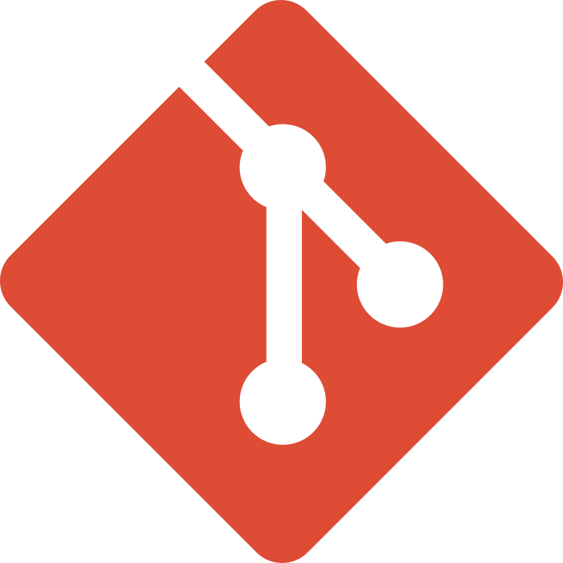

``` java
System.out.println("Hi everyone, I am...");
```


**Your IT partner**


I build software, automate processes and explore new technologies.

<strong>🧪 What I build</strong>

- Software & web applications
- Scripts for tasks automation & integrations
- APIs & backend systems

<strong>What I like to do</strong>

- Experimenting with technologies and testing the limits of my skills.

<div align="center">
  <a href="#-projects">
    
  </a>
  &nbsp;&nbsp;&nbsp;&nbsp;
  <a href="#-find-me">
    
  </a>
</div>

---

``` python
class Developer:
    def __init__(self):
        self.name = "Piotr"
        self.country = "Poland"
        self.github = "github.com/piotrszwedo"
        self.editors = ["PhpStorm", "Visual Studio Code", "PyCharm", "IntelliJ"]
        
    def find_me(self, your_name):
        print(f"👋 Hey {your_name}!")
        print("🔗 LinkedIn → linkedin.com/in/piotrszwedo")
        print("📧 Email    → piotrszwedo2007@gmail.com")

```
---

## 🛠 Tech Stack

<div align="center">

### 💻 Languages

<table>
  <tr>
    <td align="center" width="120">
      <br>
    </td>
    <td align="center" width="120">
      <br>
    </td>
    <td align="center" width="120">
      <br>
    </td>
    <td align="center" width="120">
      <br>
    </td>
    <td align="center" width="120">
      <br>
    </td>
    <td align="center" width="120">
      <br>
    </td>
  </tr>
</table>

### 🌐 Web & Data

<table>
  <tr>
    <td align="center" width="120">
      <br>
    </td>
    <td align="center" width="120">
      <br>
    </td>
    <td align="center" width="120">
      <br>
    </td>
    <td align="center" width="120">
      <br>
    </td>
    <td align="center" width="120">
      <br>
    </td>
  </tr>
</table>

### ⚙️ Infrastructure & Tools

<table>
  <tr>
    <td align="center" width="120">
      
    </td>
    <td align="center" width="120">
      
    </td>
    <td align="center" width="120">
      
    </td>
    <td align="center" width="120">
      
    </td>
  </tr>
</table>

### 🖥️ Environments

<table>
  <tr>
    <td align="center" width="120">
      
    </td>
    <td align="center" width="120">
      
    </td>
    <td align="center" width="120">
      
    </td>
  </tr>
</table>

</div>

---

## 🔬 Projects

### [ESKUEL](https://github.com/PiotrSzwedo/ESKUEL)

An educational application for working with databases.
ESKUEL supports standard SQL as well as a Polish-inspired SQL syntax.

### [Termy-backend](https://github.com/smartfrigde/termy-backend)

An API and proxy server for managing SSH and GPG keys,
designed for developers, system administrators and teams.

More experiments and projects can be found across my repositories.

---

## 🌐 Find me

- 💼 **LinkedIn** — [linkedin.com/in/piotrszwedo](https://linkedin.com/in/piotrszwedo)
- 📧 **Email** — piotrszwedo2007@gmail.com
- 💬 **Discord** — unlxsted_

---
